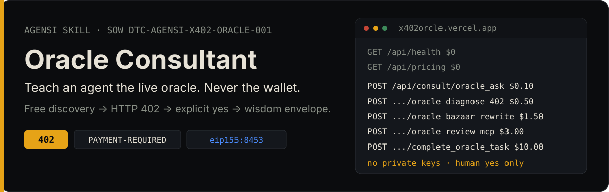
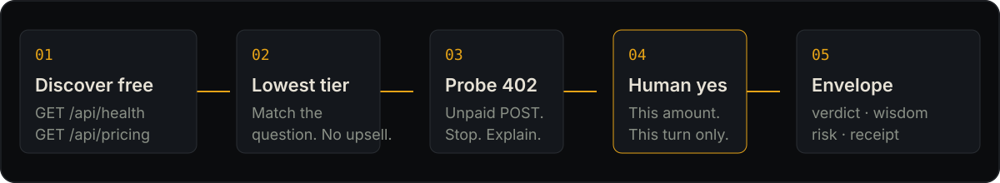

<p align="center">
  
</p>

This repository is the **build window** for the Agensi skill `x402-oracle-consultant`. It is not the live oracle, not a wallet, and not the marketplace listing.

Live host (spelling is `orcle`, do not “fix” it): [x402orcle.vercel.app](https://x402orcle.vercel.app)

<p align="center">
  
</p>

## What it does

An MCP-capable agent that loads the finished skill can take a user from a question to a wisdom envelope without reverse-engineering the host:

1. Hit free `GET /api/health` and `GET /api/pricing` first.
2. Recommend the **lowest** paid tier that fits.
3. Show the unpaid `POST /api/consult/<tier>` → HTTP 402 + `PAYMENT-REQUIRED`.
4. Stop until the user says yes to **this amount, this turn**.
5. Present `verdict`, `wisdom`, `implementation_prompt`, `risk`, `citations`, `receipt`.

Body for every paid consult:

```json
{"question": "<user question>"}
```

## Live lock (verified 2026-10-30)

| Name | Method | Path | USD |
|------|--------|------|-----|
| oracle_health | GET | `/api/health` | 0 |
| oracle_pricing | GET | `/api/pricing` | 0 |
| oracle_ask | POST | `/api/consult/oracle_ask` | 0.10 |
| oracle_diagnose_402 | POST | `/api/consult/oracle_diagnose_402` | 0.50 |
| oracle_bazaar_rewrite | POST | `/api/consult/oracle_bazaar_rewrite` | 1.50 |
| oracle_review_mcp | POST | `/api/consult/oracle_review_mcp` | 3.00 |
| complete_oracle_task | POST | `/api/consult/complete_oracle_task` | 10.00 |

Network: Base USDC (`eip155:8453`). Bare `/api/consult` is 404. Re-curl before every zip.

```bash
curl -sS https://x402orcle.vercel.app/api/health
curl -sS https://x402orcle.vercel.app/api/pricing
```

## Read this repo

1. [STATUS.md](STATUS.md) — last 24 hours (rewritten daily at 07:00 America/Chicago)
2. [docs/SOW.md](docs/SOW.md) — in / out of v1, acceptance, commercial
3. [docs/PRD-specific.md](docs/PRD-specific.md) — skill requirements
4. [docs/SOP-specific.md](docs/SOP-specific.md) — zip and Agensi submit
5. [progress/](progress/) — dated journal

Supporting: [docs/PRD.md](docs/PRD.md), [docs/Agensi-Skill-Building-SOP.md](docs/Agensi-Skill-Building-SOP.md).

## State

| Item | State |
|------|--------|
| SOW | `DTC-AGENSI-X402-ORACLE-001` — ready to execute |
| SKILL.md | Gated on owner **execute** |
| Zip / Agensi listing | Not started |
| Listing price | $15 one-time (Agensi; 70% creator share) |

Quiet STATUS = no paper moved. Do not backfill fake tasks.

## Hard stops

- Never request or store private keys, seeds, or spend wallets.
- Never send a payment signature without a current-turn yes for the live amount.
- Never contact a host other than `x402orcle.vercel.app`.
- Never fall back to another oracle if this host is down.
- This skill does not replace the live oracle. It drives traffic to it.

## Partners

Private org [x402-oracle](https://github.com/x402-oracle). Dillon Bowen and Keith (`kwizzlesurp10-ctrl`) work this together.

Access notes: [CLIENT-ACCESS.md](CLIENT-ACCESS.md)
